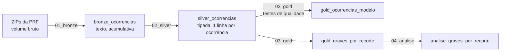

# Acidentes graves nas rodovias federais

Autor: Deyvid Prado.

Pipeline de dados no Databricks com os acidentes registrados pela Polícia Rodoviária Federal de 2017 a 2025. As camadas bronze, silver e gold ficam em Delta Lake, no Unity Catalog, e os testes de qualidade param o pipeline quando o dado está errado. A análise final mostra onde e quando os acidentes graves acontecem, de 2019 a 2025.

## Sobre este projeto

É um projeto de estudo, feito para aprender Databricks e Spark. A regra do projeto é que eu consiga explicar cada teste e cada decisão, e o [`docs/explicacao.md`](docs/explicacao.md) existe para isso: diz o que cada técnica é, por que está aqui e como eu a explicaria numa entrevista.

## Pergunta e medida

Dado que houve um acidente, qual a chance de ele ter sido grave, conforme o lugar, a hora, a via e o clima? Grave é o acidente com pelo menos um morto ou ferido grave.

A fonte não tem volume de tráfego, então uma contagem de acidentes não mede risco. A medida usada é a proporção de graves entre os acidentes de cada recorte, com intervalo de confiança de 95% (Wilson).

## Resultados

De 2019 a 2025 foram 473.813 acidentes, e 28,0% deles foram graves. A análise completa, com o arquivo de origem de cada número, está em [`docs/analise.md`](docs/analise.md).

- Maranhão (45,2%), Pará (40,8%) e Piauí (39,8%) têm a maior proporção de graves; São Paulo (18,5%) e Distrito Federal (18,7%), a menor.
- As 12 horas entre 18h e 5h ficam acima da média, e as 12 entre 6h e 17h, abaixo. Domingo e sábado são os únicos dias acima da média.
- Na pista simples, 33,3% dos acidentes são graves, contra 23,1% na pista dupla.
- Atropelamento de pedestre (67,7%) e colisão frontal (62,5%) são os tipos mais graves. A colisão frontal também é o tipo com mais mortos: 12.205 em sete anos.
- A BR-101 e a BR-116 concentram o maior número de acidentes graves, mas a proporção de graves nelas fica abaixo da média.

Repeti todas as comparações só entre os acidentes com vítima, o que tira o efeito de lugares que registram mais ou menos acidentes leves. Os padrões de região e de horário se mantêm. O álcool do condutor muda de lado: fica abaixo da média entre todos os acidentes e acima dela entre os com vítima.

## Página

A página está publicada em <https://deyv7.github.io/acidentes-prf/>. O código fica em `web/` e conta a análise como uma viagem: cada parada é um fator (lugar, via, hora, tempo, causa, tipo de acidente) e mostra a proporção de graves com o intervalo de 95%. No fim há um explorador com os 13 recortes, as duas contas (todos os acidentes e só com vítima), busca e ordenação.

A página não tem número escrito à mão. `src/exportar_web.py` lê `resultados/` e grava os JSON em `web/public/dados/`, conferindo que cada recorte soma o total da gold; os textos são montados a partir desses JSON. Em tela grande os cards correm na horizontal com a rolagem (GSAP ScrollTrigger); em tela pequena, ou com movimento reduzido no sistema, ficam empilhados.

## Pipeline



A lógica fica em funções Python em `src/`, testadas com pytest e Spark local, e os notebooks em `notebooks/` só chamam essas funções. O código chega ao Databricks como um wheel instalado a partir de um volume. O pipeline roda localmente e no Databricks, e `resultados/fase*_conferencia_databricks.csv` compara os números das duas execuções; até aqui eles batem em todas as tabelas.

A `gold_ocorrencias_modelo` foi preparada para um modelo de gravidade. Tem uma linha por ocorrência, o alvo `grave` e nenhuma coluna de desfecho (mortos, feridos, classificação), e um teste falha se alguma delas entrar.

## Qualidade dos dados

As regras de `src/qualidade.py` rodam no pipeline, sobre os dados reais. Uma regra bloqueante para o pipeline se reprovar qualquer linha. Uma regra com tratamento conta as linhas e registra o que a silver fez com elas. Na fonte de 2017 a 2025 (`resultados/fase2_qualidade.csv`):

| Regra | Linhas reprovadas | O que foi feito |
|---|---|---|
| `id` nulo ou repetido, data fora do ano do arquivo, dia da semana diferente do da data, contagem negativa, classificação que contradiz mortos e feridos | 0 | bloqueantes: o pipeline para se aparecer alguma |
| coordenada fora do Brasil | 57, todas em 2017 | latitude e longitude anuladas; a ocorrência fica |
| classificação ausente | 1 ou 2 por ano | derivada das contagens e marcada |
| `pessoas` menor que a soma das contagens | entre 3.098 e 4.572 por ano | as análises usam a soma, que fecha com o arquivo por pessoa |

A validação da fonte achou uma quebra na série em abril de 2018 (por isso a análise começa em 2019), ids escritos em notação científica (`1e+05`), a troca da lista de causas em janeiro de 2021 e um acidente real em Fernando de Noronha que uma caixa simples de coordenadas descartaria. Os detalhes estão em [`docs/validacao-fonte.md`](docs/validacao-fonte.md).

## Como rodar

Os testes rodam num container Linux com Spark e Delta, sem rede:

```bash
docker build -f docker/Dockerfile.testes -t acidentes-prf-testes .
docker run --rm --network none --hostname localhost -e SPARK_LOCAL_IP=127.0.0.1 \
  -v "$PWD:/app" acidentes-prf-testes python -m pytest -q
```

Pipeline local nos ZIPs da PRF (pasta com `ocorrencia_<ano>/ocorrencia_<ano>.zip`), gerando `resultados/`:

```bash
docker run --rm --network none --hostname localhost -e SPARK_LOCAL_IP=127.0.0.1 \
  -v "$PWD:/app" -v "<pasta dos zips>:/dados/bruto:ro" -v "<pasta do lake>:/lake" \
  acidentes-prf-testes python -m src.executar_local --dados /dados/bruto --lake /lake
```

No Databricks (Free Edition), com a CLI autenticada num perfil:

```bash
databricks/implantar.sh <perfil> <pasta dos zips>
```

O script importa os notebooks, cria o schema e os volumes, sobe o wheel e os ZIPs, roda o job e compara a saída com `resultados/`. As versões estão fixas em `requirements.txt`: pyspark 4.0.1 e delta-spark 4.0.1, as mesmas do ambiente serverless versão 4.

Página, a partir de `resultados/` (Python só com a biblioteca padrão e Node 20 ou mais novo):

```bash
python -I src/exportar_web.py
cd web && npm ci && npm run dev      # ou npm run build, que gera web/dist/
```

## Estrutura

```
src/          bronze, silver, qualidade, gold, análise e scripts de execução
tests/        pytest com Spark local
notebooks/    00_configurar a 04_analise, só chamam src/
databricks/   job e script de implantação
resultados/   saída de toda consulta citada nos documentos
docs/         validação da fonte, explicação das decisões e análise
web/          página da análise (Vite, GSAP, Lenis); dados em web/public/dados/
dados_externos/  malha das UFs do IBGE, usada só no contorno do mapa
```

## Limitações

Sem volume de tráfego, a proporção de graves mede a gravidade dos acidentes que aconteceram, e não o risco de dirigir num lugar. A análise olha um recorte de cada vez e por isso não separa o efeito da noite do efeito da pista simples ou da região; essa separação fica para o modelo. As outras limitações estão em [`docs/analise.md`](docs/analise.md).

## Fonte

Polícia Rodoviária Federal, dados abertos de sinistros de trânsito agrupados por ocorrência (2017 a 2025), baixados em 4 de novembro de 2026: <https://www.gov.br/prf/pt-br/acesso-a-informacao/dados-abertos/dados-abertos-da-prf>. A licença e a referência completa estão em [`docs/validacao-fonte.md`](docs/validacao-fonte.md). O projeto é independente e não tem vínculo com a PRF.

O contorno das UFs no mapa da página vem da malha do IBGE em qualidade mínima (API `servicodados.ibge.gov.br/api/v3/malhas`, baixada em 4 de novembro de 2026 para `dados_externos/malha_uf_ibge.geojson`). Ela só desenha as divisas; nenhum número sai dela.
